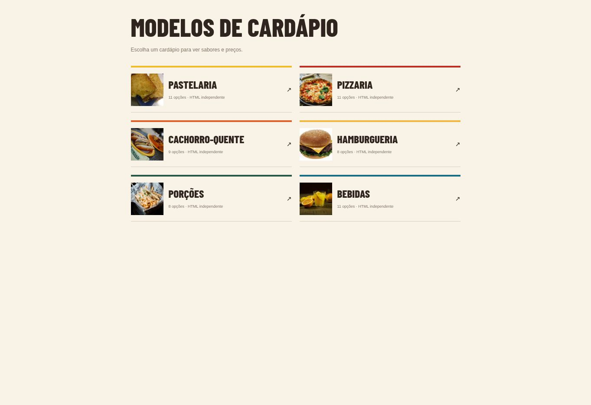

# Cardápio digital

Coleção de modelos de cardápio com navegação por categoria, sabores e preços.

**[Abrir demonstração](https://yagog0.github.io/cardapio-digital/)**



## Categorias
| Página | Conteúdo |
| --- | --- |
| `pastel.html` | Pastelaria |
| `pizza.html` | Pizzaria |
| `cachorro-quente.html` | Cachorro-quente |
| `hamburguer.html` | Hamburgueria |
| `porcoes.html` | Porções |
| `bebidas.html` | Bebidas |

A página `index.html` reúne os links dos modelos. O repositório também contém `personalizar.html`.

## Executar localmente
```bash
git clone https://github.com/Yagog0/cardapio-digital.git
cd cardapio-digital
```

Abra `index.html` no navegador. Alternativamente, com Python instalado:

```bash
python -m http.server 8000
```

Acesse `http://localhost:8000`.

## Personalizar
Edite os textos, produtos e preços nos arquivos HTML correspondentes. O projeto apresenta modelos visuais; a publicação da interface não representa uma integração concluída de pedidos ou pagamentos.

## Tecnologias
Páginas HTML com estilos de interface web. A página inicial inclui imagens incorporadas no próprio HTML.

Desenvolvido por [Yago Maba](https://github.com/Yagog0).
